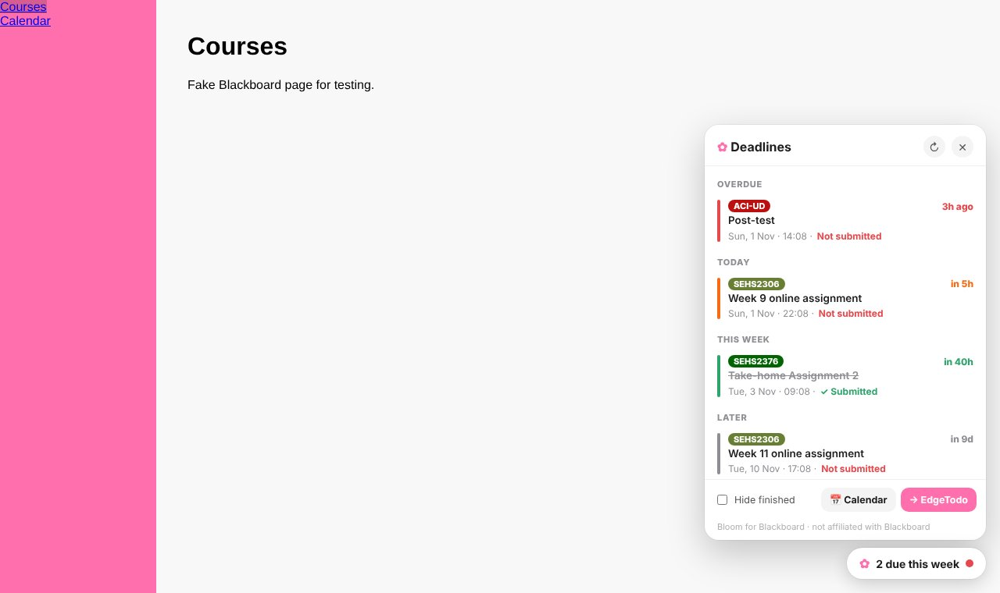
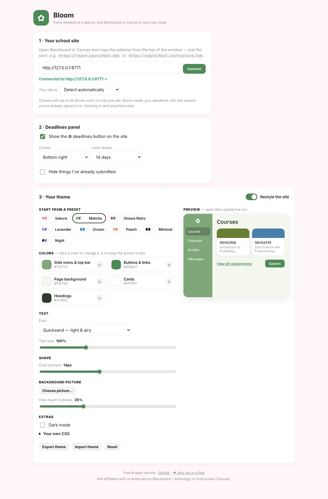
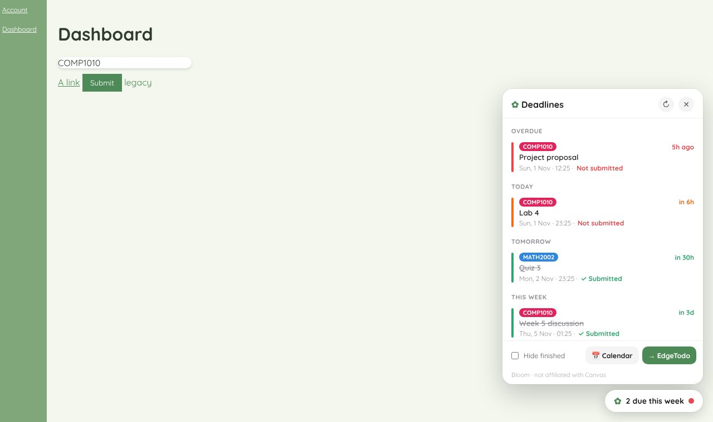

# Bloom ✿

**English** | [繁體中文](README.zh-Hant.md) | [简体中文](README.zh-Hans.md)

**Every Blackboard and Canvas deadline at a glance, and your school site in your own style.**

Bloom is a small Chrome extension for students on **Blackboard Learn (Ultra)** or **Canvas**. A ✿ button on every page lists your upcoming deadlines across all your courses, with a countdown and whether you've already submitted. You can send them to your calendar or to [EdgeTodo](https://github.com/tllct122/edge-todo-for-mac), and restyle the site with your own colors, fonts and background picture.

## Features

- ⏰ **All deadlines in one place**: every course, sorted by what's due first (Overdue · Today · Tomorrow · This week · Later)
- ✓ **Knows what you've handed in**: reads your submission status from Blackboard or Canvas and crosses out finished work
- 🔴 **Countdown & colors**: "in 5h" in orange and overdue in red, so the urgent ones stand out
- 🔢 **Toolbar badge**: the extension icon shows how many deadlines are due within 24 hours (or 3 days)
- 📅 **Add to your calendar**: one click downloads a calendar file with a reminder the day before (Apple Calendar, Google Calendar, Outlook)
- ✅ **Send to EdgeTodo**: deadlines go straight into EdgeTodo's screen-edge to-do list with their due dates
- ☑️ **Mark done**: tick off things the site can't track, like offline tasks
- 🔒 **Private**: runs only on the one site you connect, uses the session you're already signed in with, and keeps everything in your browser. No servers, no tracking

## Make it yours 🎨

Nothing is fixed. Start from a preset or build your own theme from scratch:

- **8 presets**: Sakura, Matcha, Showa Retro, Lavender, Ocean, Peach, Minimal, Night
- **5 separate colors**: side menu & top bar, buttons & links, page background, cards and headings. Pick any color, or ⌀ to keep your school's own
- **Any font**: three bundled rounded fonts (Nunito, Fredoka, Quicksand), any font installed on your computer, or upload a font file (.ttf .otf .woff .woff2). Chinese text falls back to your system font
- **Text size** (80–140%) and **card corner roundness**
- **Background picture** with a slider for how much it shows through
- **Dark mode**
- **Your own CSS** for anything else
- **Export / import themes** as a file, so you can share them with friends
- **Live preview**, and any open Blackboard or Canvas tabs update as you change things

> Not affiliated with or endorsed by Blackboard / Anthology or Instructure (Canvas). Built and tested with Blackboard Learn Ultra and Canvas LMS.

## Install

1. Download this repo (**Code → Download ZIP**) and unzip it
2. In Chrome, go to `chrome://extensions` and turn on **Developer mode** (top right)
3. Click **Load unpacked** and choose the unzipped folder
4. The settings page opens. Paste your school site's address (e.g. `https://learn.yourschool.edu` or `https://yourschool.instructure.com`), click **Connect**, then **Allow**
5. Open Blackboard or Canvas and click the ✿ button in the bottom-right corner

Works in Chrome, Edge, Arc, Brave and other Chromium browsers. Bloom detects Blackboard or Canvas by itself; if your school has customised its site a lot, choose it under **This site is** in settings.

## Usage

| Action | How |
|---|---|
| See deadlines | Click **✿** on any page of the site, or the extension icon in the toolbar |
| Open an assignment | Click a deadline |
| Tick something off yourself | Hover a deadline → **Mark done** |
| Hide finished work | **Hide finished** at the bottom of the panel |
| Add to your calendar | **📅 Calendar**, then open the downloaded `.ics` file |
| Send to EdgeTodo | **→ EdgeTodo**: EdgeTodo imports it if **Settings → Import** is on, or use its menu → **Import Tasks…** |
| Change the theme | Extension icon → ⚙︎ → **Your theme** |
| Share a theme | **Export theme** → send the file → your friend clicks **Import theme** |

## Privacy

Bloom only runs on the one address you connect. It reads your deadlines and submission status through Blackboard's or Canvas's own web API with your existing login, which is the same data you already see on the site. It never sees your password, and nothing is sent to anyone else. Your settings, theme and deadline list are stored in your browser only.

## Support

If Bloom saved you from a missed deadline, you can support it here:

- ☕ Buy Me a Coffee: https://buymeacoffee.com/sirene122

## License

[MIT](LICENSE). Bundled fonts (Nunito, Fredoka, Quicksand) are under the SIL Open Font License; see `fonts/`.
