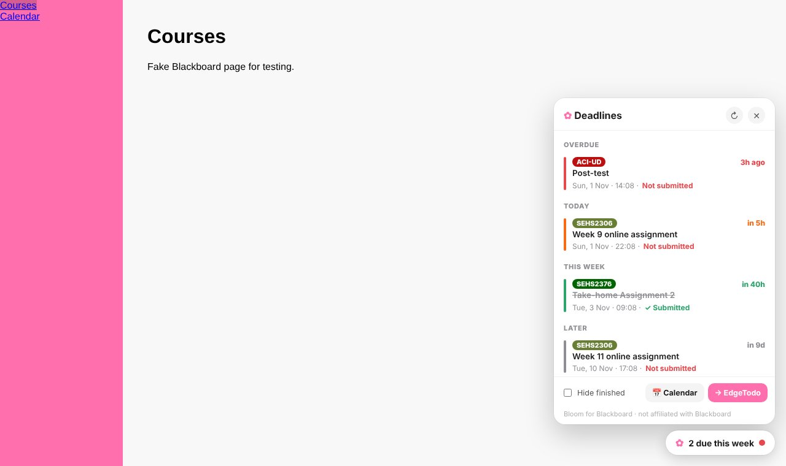

# Bloom for Blackboard ✿

[English](README.md) | [繁體中文](README.zh-Hant.md) | **简体中文**

**一眼看清所有 Blackboard 截止日期，还可以把 Blackboard 换成你喜欢的颜色。**

给使用 Blackboard Learn（Ultra）的学生用的 Chrome 扩展程序。每个 Blackboard 页面都会有一个 ✿ 按钮，列出所有课程即将到期的作业，附倒计时，还会显示你是否已经提交。可以一键加入日历或发送到 [EdgeTodo](https://github.com/tllct122/edge-todo-for-mac)，也可以为 Blackboard 换上你喜欢的颜色、字体或深色模式。

## 功能

- ⏰ **所有截止日期集中一处**：所有课程，按到期先后排列：Overdue · Today · Tomorrow · This week · Later
- ✓ **知道你交了没有**：从 Blackboard 读取提交状态，已完成的会划线
- 🔴 **倒计时与颜色**：“in 5h”显示为橙色，逾期显示为红色，紧急的一眼就看到
- 🔢 **工具栏数字**：扩展图标会显示 24 小时（或 3 天）内到期的数量
- 📅 **加入日历**：一键下载日历文件，附前一天提醒（Apple 日历、Google 日历、Outlook）
- ✅ **发送到 EdgeTodo**：截止日期直接加入 EdgeTodo 的屏幕边待办清单
- 🎨 **美化 Blackboard**：把学校的主色换成你喜欢的颜色、换字体，或打开深色模式
- ☑️ **手动标记完成**：Blackboard 追踪不到的事（例如线下作业）可以自己勾掉
- 🔒 **隐私**：只在你学校的 Blackboard 网站运行，使用你已登录的账号，所有数据只保存在你的浏览器。没有服务器，不会追踪

> 与 Blackboard / Anthology 没有任何关系，亦未获其认可。基于 Blackboard Learn Ultra 开发及测试。

## 安装

1. 下载这个仓库（**Code → Download ZIP**），然后解压
2. 在 Chrome 打开 `chrome://extensions`，打开右上角的 **开发者模式**
3. 点击 **加载已解压的扩展程序**，选择解压后的文件夹
4. 设置页会自动打开，粘贴你的 Blackboard 网址（例如 `https://learn.yourschool.edu`），点击 **Connect**，再点 **允许**
5. 打开 Blackboard，点击右下角的 ✿ 按钮

适用于 Chrome、Edge、Arc、Brave 等 Chromium 浏览器。

## 使用方法

| 操作 | 方法 |
|---|---|
| 查看截止日期 | 在任何 Blackboard 页面点击 **✿**，或点击工具栏的扩展图标 |
| 打开该作业的课程 | 点击该截止日期 |
| 自己标记完成 | 鼠标移到项目上 → **Mark done** |
| 隐藏已完成 | 面板底部的 **Hide finished** |
| 加入日历 | **📅 Calendar**，然后打开下载的 `.ics` 文件 |
| 发送到 EdgeTodo | **→ EdgeTodo**：如 EdgeTodo 已打开 **Settings → Import** 就会自动导入，或用它的菜单 → **Import Tasks…** |
| 颜色、字体、深色模式、位置、显示多少天 | 扩展图标 → ⚙︎ |

## 隐私

Bloom 只会在你连接的那个 Blackboard 网址运行。它用你现有的登录，通过 Blackboard 本身的网络接口读取日历和提交状态，也就是你在 Blackboard 上本来就能看到的数据。它不会看到你的密码，也不会把任何数据发给其他人。设置和截止日期清单只会保存在你的浏览器。

## 支持

如果 Bloom 帮你避免了一次迟交，欢迎在这里支持：

- ☕ Buy Me a Coffee：https://buymeacoffee.com/sirene122

## 许可证

[MIT](LICENSE)
