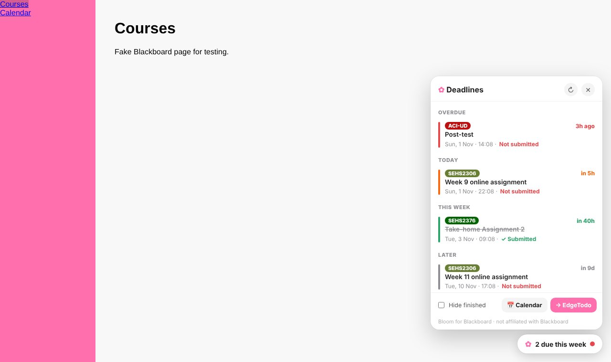

# Bloom for Blackboard ✿

[English](README.md) | **繁體中文** | [简体中文](README.zh-Hans.md)

**一眼看清所有 Blackboard 截止日期，還可以把 Blackboard 換成你喜歡的顏色。**

給使用 Blackboard Learn（Ultra）的學生用的 Chrome 擴充功能。每個 Blackboard 頁面都會有一個 ✿ 按鈕，列出所有科目即將到期的功課，附倒數時間，還會顯示你是否已經提交。可以一鍵加入日曆或傳送到 [EdgeTodo](https://github.com/tllct122/edge-todo-for-mac)，也可以為 Blackboard 換上你喜歡的顏色、字型或深色模式。

## 功能

- ⏰ **所有截止日期集中一處**：所有科目，按到期先後排列：Overdue · Today · Tomorrow · This week · Later
- ✓ **知道你交了沒有**：從 Blackboard 讀取提交狀態，已完成的會劃線
- 🔴 **倒數與顏色**：「in 5h」顯示為橙色，逾期顯示為紅色，緊急的一眼就看到
- 🔢 **工具列數字**：擴充圖示會顯示 24 小時（或 3 天）內到期的數量
- 📅 **加入日曆**：一鍵下載日曆檔，附前一天提醒（Apple 日曆、Google 日曆、Outlook）
- ✅ **傳送到 EdgeTodo**：截止日期直接加入 EdgeTodo 的螢幕邊待辦清單
- 🎨 **美化 Blackboard**：把學校的主色換成你喜歡的顏色、換字型，或開啟深色模式
- ☑️ **手動標記完成**：Blackboard 追蹤不到的事（例如實體功課）可以自己剔走
- 🔒 **私隱**：只在你學校的 Blackboard 網站運作，使用你已登入的帳戶，所有資料只存在你的瀏覽器。沒有伺服器，不會追蹤

> 與 Blackboard / Anthology 沒有任何關係，亦未獲其認可。以 Blackboard Learn Ultra 開發及測試。

## 安裝

1. 下載這個 repo（**Code → Download ZIP**），然後解壓縮
2. 在 Chrome 打開 `chrome://extensions`，開啟右上角的 **開發人員模式**
3. 點擊 **載入未封裝項目**，選擇解壓縮後的資料夾
4. 設定頁會自動打開，貼上你的 Blackboard 網址（例如 `https://learn.yourschool.edu`），點擊 **Connect**，再按 **允許**
5. 打開 Blackboard，點擊右下角的 ✿ 按鈕

適用於 Chrome、Edge、Arc、Brave 等 Chromium 瀏覽器。

## 使用方法

| 動作 | 方法 |
|---|---|
| 查看截止日期 | 在任何 Blackboard 頁面點擊 **✿**，或點擊工具列的擴充圖示 |
| 打開該功課的課程 | 點擊該截止日期 |
| 自己標記完成 | 滑鼠移到項目上 → **Mark done** |
| 隱藏已完成 | 面板底部的 **Hide finished** |
| 加入日曆 | **📅 Calendar**，然後打開下載的 `.ics` 檔 |
| 傳送到 EdgeTodo | **→ EdgeTodo**：如 EdgeTodo 已開啟 **Settings → Import** 就會自動匯入，或用它的選單 → **Import Tasks…** |
| 顏色、字型、深色模式、位置、顯示多少天 | 擴充圖示 → ⚙︎ |

## 私隱

Bloom 只會在你連接的那個 Blackboard 網址運作。它用你現有的登入，透過 Blackboard 本身的網絡介面讀取日曆和提交狀態，也就是你在 Blackboard 上本來就看到的資料。它不會看到你的密碼，也不會把任何資料傳給其他人。設定和截止日期清單只會儲存在你的瀏覽器。

## 支持

如果 Bloom 幫你避過一次遲交，歡迎在這裡支持：

- ☕ Buy Me a Coffee：https://buymeacoffee.com/sirene122

## 授權

[MIT](LICENSE)
